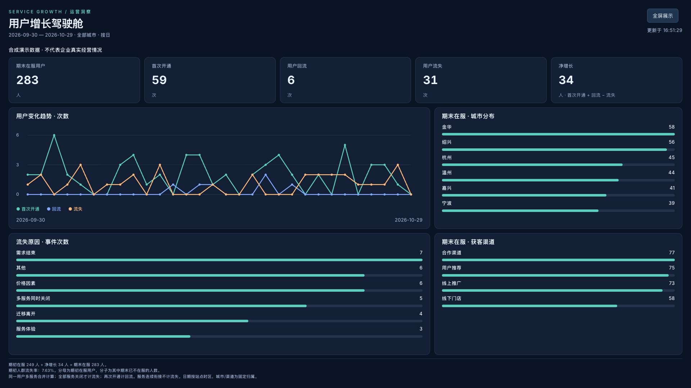

# Service Growth｜服务增长洞察

Frappe 原生自定义 App：服务生命周期单据、用户增长 Script Report 和运营大屏 Desk Page。所有演示记录均为合成数据，业务口径仅用于笔试方案，不代表招聘方实际制度。

## 交付结构

- `service_growth/growth/doctype/service_record/`：服务周期 DocType、日期及重叠校验。
- `service_growth/analytics.py`：纯函数统计内核，多服务周期合并、用户状态变化、快照与归因。
- `service_growth/api.py`：登录、角色、单据权限、过滤范围和数据规模保护。
- `service_growth/growth/report/user_growth/`：原生 Script Report，支持日/月、日期、城市筛选。
- `service_growth/growth/page/growth_dashboard/`：原生 Desk Page，全屏、趋势、城市、渠道和流失原因。
- `service_growth/mock.py`：固定随机种子与锚点的演示数据，显式导入。
- `tests/`：可独立运行的统计测试；DocType目录包含真实Frappe集成测试。

## 安装（目标 Frappe v15）

需先准备官方 Bench 和独立测试站点，勿在真实生产站点试装。站点时区建议 Asia/Shanghai。

```sh
# 在已有 frappe-bench 目录执行；先将本仓库放在可访问的本地路径
bench get-app /absolute/path/to/service_growth
bench --site growth.localhost install-app service_growth
bench --site growth.localhost migrate
bench --site growth.localhost execute service_growth.mock.seed
bench build --app service_growth
bench start
```

导入默认锚点 `2026-10-29`，生成505条服务周期，覆盖360位合成用户及其多服务、关闭和回流周期。默认重复执行不重复插入。不同锚点不混用同一站点；存在冲突会停止，避免破坏数据。mock不在安装时自动导入，也不自动删除记录。

```sh
# 指定其他固定锚点（首次导入且不能晚于站点当天）
bench --site growth.localhost execute service_growth.mock.seed --kwargs '{"anchor":"2026-10-29"}'
```

Administrator可直接访问。其他系统用户由管理员分配 `Growth Viewer`（只读/报表）或 `Growth Manager`（新增/修改/报表）角色。该演示采用完整用户历史访问，禁止将同一用户的服务历史拆分授权，否则用户级指标会失真；如需按组织隔离，应先建立用户归属与完整历史权限规则。

入口：
- `/app/service-record`：服务单据列表。
- `/app/query-report/User%20Growth`：增长报表。
- `/app/growth-dashboard`：大屏，默认最近30天；查看预设完整数据可选2026-05-01至2026-10-29。

## 指标与边界

服务有效区间为 `[开通时间,关闭时间)`；同一用户任一服务在服即为在服用户。重叠或相接的服务区间合并后，首次进入在服记首次开通；后续重新进入记回流；所有服务均关闭才记流失。日/月末快照在下一周期零点事件发生前计算，午夜事件归新周期。所有时间为站点时区的本地时间。

`期初人数 + 首次开通次数 + 回流次数 − 流失次数 = 期末人数`。同一用户可在期间多次流失/回流，事件次数不等于去重人数。流失原因来自最终关闭服务；多项服务同刻关闭且原因不同，归为“多服务同时关闭”。

期初人群流失率 = 期初在服、期末不在服的人数 / 期初在服人数；期初为0时显示“—”。它衡量期初人群期末状态，期间已流失又回流的不计入分子，与“流失事件次数/期初人数”不同。

城市和渠道是固定用户归属，单据校验一致性；区域分布按期末在服去重用户统计。不开通跨城迁移口径，不将其解释为企业实际运营范围。

## 验证

```sh
# 无Frappe也可执行：真实统计逻辑测试
python3 -m unittest discover -s tests -v
# 独立Frappe测试站点：验证DocType与权限
bench --site growth.localhost set-config allow_tests true
bench --site growth.localhost run-tests --app service_growth
```

实际验证进展见 `docs/verification.md`。纯函数通过不代表Frappe安装、权限和浏览器已通过，所有结果分开记录。

## 演示规模与演进

每次分析最多读取50000条权限可见历史记录，日期跨度最多367个自然日；超限明确拒绝，避免静默截断。统计使用历史周期计算期初，不能只查询本期新增。演示写入用事务内数据库锁串行校验，适合小规模，非大规模并发方案；生产可改为用户主档行锁、按用户事件增量投影及日快照。大屏显式刷新，不自动轮询，避免无意义负载与隐藏过期状态。

更正历史服务周期会重算历史报表；本版依靠Frappe变更跟踪保留修改记录，不作为财务不可变账本。角色无删除权限，演示无需外部地图、分析服务或上传真实个人信息。

## 提交边界

本目录可独立作为Git仓库发布。勿上传上级简历目录、`.runtime`、数据库、站点配置、密码或测试登录凭据。公开仓库及代交须由用户核对具体目标后授权。

官方技术依据（核验日期2026-10-29）：[安装依赖](https://docs.frappe.io/framework/user/en/installation)、[Script Report](https://docs.frappe.io/framework/user/en/desk/reports/script-report)、[Page API](https://docs.frappe.io/framework/user/en/api/page)。目标测试源码固定为官方标签 `v15.88.0`；不要把对一个版本的验证视为对所有v15或v16版本的兼容保证。

本次实际验证环境：Frappe 15.88.0 / Python 3.12.16 / PostgreSQL 15.15 / Redis 7.2.7。旧版框架依赖在本地需要 setuptools<81（实际80.10.2）；该环境约束不代表已验证其他数据库或框架版本。新建Frappe站点须完成首次设置向导，再访问Desk页面。

## 实际运行截图


